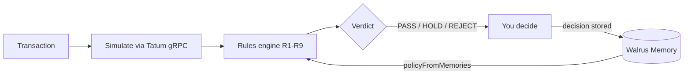

# Kawal

**A transaction checkpoint for Sui that remembers your decisions.**

Kawal sits between you and a transaction signature. It simulates what a transaction will do, checks it against a deterministic rules engine, and returns one of three verdicts: **PASS**, **HOLD** or **REJECT**. Every decision you make is stored as memory on [Walrus Memory](https://www.walrus.xyz), so the guard gets stricter in the ways you care about and never forgets across sessions.

> **Hackathon track:** Smart Agents for Real Life, [Walrus Sessions: Tatum Total Recall](https://thewalrussessions.wal.app/tatum-total-recall/index.html).  
> **Live Demo:** [https://kawals.vercel.app](https://kawals.vercel.app) · **Pitch & Video Presentation:** [Kawal_Voice.html](https://kawals.vercel.app/Kawal_Voice.html) · **Documentation:** [Penjelasan Proyek](./penjelasan%20deskripsi%20proyek.md)

## Why Kawal

Signing a transaction you do not fully understand is the most common way to lose funds. Kawal acts as a personal agent for everyday on-chain tasks:

- **Explains before you sign**: an inspection slip lists every finding step by step.
- **Remembers you**: trusted and denied recipients, plus limits, persist in Walrus Memory.
- **Deterministic**: the verdict always comes from rules, never from an LLM. An explainer may describe a verdict but can never change it.

## How it works



## Features

- Pure rules engine (`packages/rules`): no I/O, no time, no randomness.
- 12 mock market scenarios ("Pasar Tiruan") with expected verdicts.
- Hono API for mock/replay evaluation, decisions, memory, revoke and health.
- Interactive web demo with seven screens, a 3D voxel elephant mascot and a personal transfer preflight.
- 141 automated tests across rules, fixtures, API, preflight and mascot.
- Walrus Memory on Mainnet: 10/10 memories written and 10/10 recall queries returned relevant results.

## Quick start

Requires Node 22+ and pnpm 10+.

```sh
pnpm install
pnpm check        # typecheck + all tests
pnpm dev:web      # http://127.0.0.1:5173
pnpm dev:api      # http://127.0.0.1:8787
pnpm build:web
```

Copy `.env.example` to `.env.local` and fill in your own values only if you want live integrations. The demo works without any keys.

## Project structure

```
kawal/
  apps/web         demo screens, 3D scene, local rules engine, personal preflight
  apps/api         Hono: evaluation, decisions, memory, revoke
  packages/rules   pure rules engine
  packages/scenes  placeholder for shared scenes
  packages/video   placeholder for Remotion
  fixtures         12 transaction scenarios
  spikes           Walrus Memory Mainnet (10/10) & Tatum gRPC verification gates
```

## Web screens

| Route | Screen | Contents |
| --- | --- | --- |
| `#/` | Home | checkpoint, example slip, live system board |
| `#/periksa` | Check Transfer | personal preflight, limits, deny/trust lists, history, export |
| `#/pasar` | Practice | 12 transactions, filters, queue, last verdict |
| `#/slip` | Inspection Slip | step-by-step scan, findings, used memory, policy meter |
| `#/memori` | Memory | filterable atlas, detail, forget |
| `#/kurva` | Learning Curve | agreement dial, decision timeline, triggered rules |
| `#/status` | Guard Status | session vitals, live API status, local revoke |

## Rules engine

All of R2-R7 are collected so the slip shows every finding; the heaviest verdict wins: **REJECT > HOLD > PASS**. R8 and R9 apply only when R1-R7 do not trigger.

| ID | Condition | Verdict |
| --- | --- | --- |
| R1 | Simulation failed or did not answer | REJECT |
| R2 | Recipient is on the deny list | REJECT |
| R3 | Outflow exceeds personal limit | HOLD |
| R4 | New recipient and amount above new-recipient limit | HOLD |
| R5 | Unknown Move package called | HOLD |
| R6 | Non-coin object leaves the wallet | HOLD |
| R7 | Recipient flagged dangerous by a data source | HOLD |
| R8 | Trusted recipient below trusted limit | PASS |
| R9 | No rule matched | HOLD |

Default limits: total outflow 5 SUI, new recipient 1 SUI, trusted recipient 5 SUI.

- **Trust does not bypass R4**: a trusted but never-used recipient still triggers R4 above the new-recipient limit.
- **R8 is strict**: exactly 5 SUI to a trusted recipient falls to R9 (HOLD).
- **Memory becomes policy**: `policyFromMemories()` turns structured memory into deny/trust lists and thresholds. When rules conflict, the strictest value wins, so the guard never loosens by accident.

## Integrations

| Service | Role | Status |
| --- | --- | --- |
| Tatum gRPC (Sui Mainnet) | checkpoint reads and transaction simulation | checkpoint reads working (`spikes/src/tatum-check.mjs`); live simulation in progress |
| Walrus Memory (Mainnet) | persistent decision memory and recall | **Verified on Mainnet**: 10/10 memories written and 10/10 recall queries verified. See [G2-REPORT.md](./spikes/G2-REPORT.md) and [spikes/results/](./spikes/results/). |

The web demo stores its data in `localStorage` only. It makes no real signatures or transactions.

## Hackathon Submission Highlights

This project fulfills the requirements of [Walrus x Tatum: Total Recall](https://thewalrussessions.wal.app/tatum-total-recall/index.html):
- **Walrus Memory Mainnet Integration**: 10 distinct memory entries written to Mainnet relayer (`kwl_a207ee5528dcf574`), verified with 10 recall queries (top-1 accuracy 10/10). Detailed run logs and blob IDs stored in [spikes/results/](./spikes/results/) and [G2-REPORT.md](./spikes/G2-REPORT.md).
- **Tatum Sui Integration**: Connected to Tatum gRPC gateway for reading Sui Mainnet checkpoints and objects.
- **Production Web Deployment**: Hosted on Vercel at [https://kawals.vercel.app](https://kawals.vercel.app).
- **Comprehensive Indonesian Documentation**: Complete system architecture, rules engine breakdown, and product design documented in [penjelasan deskripsi proyek.md](./penjelasan%20deskripsi%20proyek.md).
- **Interactive Pitch & Voice Demo**: Animated detective elephant narrative explaining the core concept in [Kawal_Voice.html](./Kawal_Voice.html).

## Security

- API keys and delegate keys live only in `.env.local` (gitignored) and are read server-side only.
- Never use a `VITE_` prefix for secrets; `VITE_API_URL` must be a public address.
- Never commit private keys, wallet addresses tied to you, or experiment output containing account identifiers.

## Roadmap

1. Live Tatum transaction simulation.
2. Connect the web to the API instead of local evaluation.
3. On-chain delegate revoke and an LLM explainer that never changes a verdict.
4. Wallet interception, shared scenes and a Remotion demo video.
5. Full English localization of all screens.

## Acknowledgements

Built for the Walrus Sessions: Tatum Total Recall hackathon with [Walrus Memory](https://www.walrus.xyz) and [Tatum](https://tatum.io).

